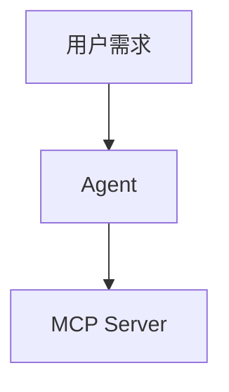

# 山水之间 · 个人网站

## 图表、公式与图片

文章中使用 `mermaid` 代码块即可绘制流程图，例如：

````markdown

````

数学公式支持行内 `$E = mc^2$`，以及单独成段的公式：

```latex
$$
P(A \mid B) = \frac{P(B \mid A)P(A)}{P(B)}
$$
```

正文图片可点击放大，按 Esc 或再次点击退出；键盘聚焦图片后按 Enter 或空格也可放大。作为链接的图片保留原来的跳转行为。

`npm run build` 会自动检查生成网页中的站内链接、图片路径和章节锚点，检查失败会阻止发布。也可在构建后运行 `npm run check:links`。检查不请求外部网站，也不会将示例代码中的路径当作真实链接。

Vue 3 + TypeScript + VitePress（基于 Vite），通过 GitHub Actions 发布到 GitHub Pages。素纸、淡墨、灰绿，配有鼠标山水视差、卡片微倾斜、点击涟漪和滚动显现。支持手机、键盘操作、日夜主题及减少动态效果偏好。

## 本地运行

使用 Node.js 22 或更新版本（Actions 使用 Node.js 24）。

Windows 用户也可以双击仓库中的 `preview.cmd`，它会启动预览并打开浏览器。预览时保留该窗口，关闭窗口即可停止服务。

```sh
npm ci
npm run dev
```

```sh
npm run check
npm run build
npm run preview
```

## 修改个人信息与头像

编辑 `docs/.vitepress/theme/site.ts` 中的 `profile`，修改姓名、简介、GitHub 地址等。`email` 为空时不展示邮件入口。

把自己的头像放入 `docs/public/images/`，将 `profile.avatar` 改成 `/images/你的图片文件名.webp`。首页、文章页和关于页会同时更新。默认头像是随站点提供的山水图案。

关于页的详细文字在 `docs/.vitepress/theme/components/About.vue`。颜色、间距和字体在 `docs/.vitepress/theme/styles.css` 的 CSS 变量中维护。

## 发布笔记

在 `docs/journal/` 下新增任意层级的 Markdown 文件，如 `docs/journal/frontend/my-note.md`：

```yaml
---
layout: article
title: 我的第一篇笔记
description: 一句话介绍文章内容。
date: '2026-10-17'
category: 前端开发
directory: 学习笔记
tags: [Vue 3, Markdown]
sample: false
---
```

在页面头部之后写正文，使用 `##` 和 `###` 建立章节目录。标题、正文、分类与标签会自动加入搜索。日期请用引号包裹，文件名建议使用英文或拼音。

## 发布项目

在 `docs/projects/` 下新增 Markdown 文件，页面头部例如：

```yaml
---
layout: project
title: 我的项目
description: 项目简介。
date: '2026-10-17'
category: Web 开发
directory: 个人站点
tags: [Vue 3, TypeScript]
cover: window
featured: true
sample: false
source: https://github.com/你的账号/项目仓库
demo: https://你的演示地址
---
```

`source` 和 `demo` 是可选字段，没有真实链接时请删除。`cover` 支持 `window`（站点）、`network`（网络节点）、`mountain`（等高线）。项目正文可以放图片，例如 ``。

分类、子目录和标签根据内容自动生成。首页展示最近的三个项目和三篇文章。带 `sample: true` 的内容会在页面上标记为示例，请在替换成真实内容后移除此标记或改为 `false`。`draft: true` 只隐藏列表与搜索，**不会阻止生成页面**；未公开内容不要提交到发布仓库。

## GitHub Pages 部署

1. 将这些文件提交并推送至 `smwy-cj/smwy-cj.github.io` 的 `main` 分支。
2. 在仓库 **Settings → Pages → Build and deployment → Source** 中选择 **GitHub Actions**。
3. 在 **Actions** 查看 `Build and deploy to GitHub Pages` 工作流。成功后访问 `https://smwy-cj.github.io/`。

工作流在拉取请求中仅检查和构建；合并或推送到 `main` 后才部署。源码仓库无需保存构建产物，也无需个人访问令牌。

当前仓库是用户主页，`base` 为 `/`。如果迁移到普通仓库的子路径，需修改 `docs/.vitepress/config.ts` 的 `base`、sitemap 域名以及 head 中的资源地址。

## 动效与阅读

- 鼠标：山水分层视差、淡墨光晕、项目卡片微倾斜。
- 滚动：区块显现、首屏轻视差、文章阅读进度。
- 点击：淡墨涟漪、筛选列表过渡、复制代码反馈。
- 搜索：点击导航搜索图标，或按 `Ctrl / ⌘ K`；支持正文、目录和标签搜索。
- 页脚的“轻动态”开关可关闭动效；系统设置“减少动态效果”时也会自动简化。
- 手机端保留原生触摸滚动，不启用鼠标跟随与卡片倾斜。

## 内容与资源

仓库中的文章和项目均明确标记为示例，没有虚构个人履历或成果数据。山水、项目封面和默认头像为 SVG 图形。中文标题采用随站点托管的思源宋体衍生字体 Noto Serif SC 子集；授权见 `docs/public/fonts/OFL.txt`，正文使用系统中文字体。

更改标题后，如果希望把新增汉字也加入本地宋体子集，可运行 `npm run font:update`（需要网络）。未包含的字符会使用系统宋体，不影响阅读。正常构建与访问不依赖字体下载服务。

GitHub Pages 托管静态内容。文章发布和头像更换通过修改仓库完成；在线上传、账户管理或模型推理需要另外接入服务。
