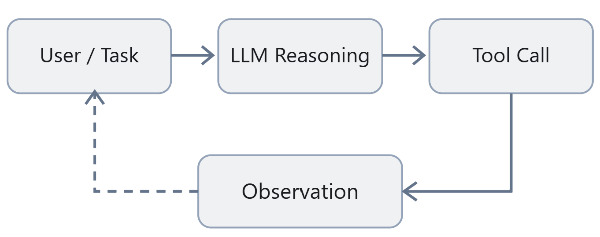
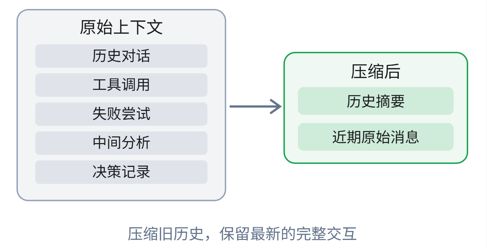
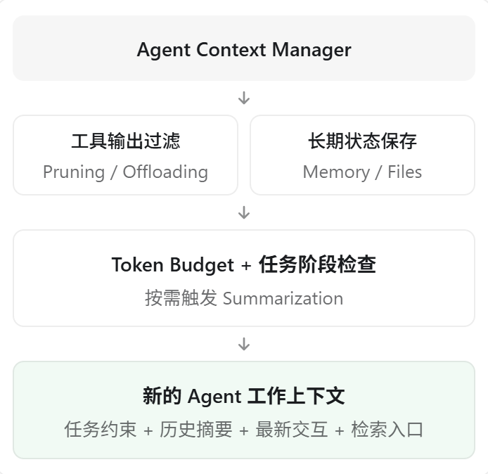

## 简介

Agent 工作模式简易展示：



**ReAct A-T-O 架构**：用户交互模式——Actions, Thoughts, Observations，长对话任务中随着迭代次数增加，**模型历史上下文不断加长**。
$$
C_t=I+H_t+O_t+M_t
$$
其中

- \(I\)：系统指令、工具定义等
- \(H_t\)：历史对话和执行轨迹
- \(O_t\)：工具输出与环境观察
- \(M_t\)：任务相关记忆


进而引发上下文爆炸（Context explosion）的问题，主要表现为**三种形式**：

1. Token 成本与推理延迟增加：历史消息反复进入模型输入。
2. Context Rot（上下文退化）：大量无关信息干扰模型定位有效证据，可能降低决策质量。
3. 上下文窗口耗尽：长任务最终无法容纳全部历史信息。


因此压缩的核心优化目标可以近似表示为：
$$
\min |\widetilde C_t| \quad \text{s.t.}\quad \Delta Q(C_t,\widetilde C_t)\le \epsilon
$$
即在可接受的任务质量损失范围内，尽量减小上下文大小。


## 五类核心压缩技术

| 技术                                  | 核心思路                                   | 主要优势                 | 主要局限                         |
| ------------------------------------- | ------------------------------------------ | ------------------------ | -------------------------------- |
| Truncation / Masking 截断与遮蔽       | 删除旧消息或指定内容                       | 实现简单、成本低         | 可能丢失重要信息                 |
| Summarization 语义摘要                | 用 LLM 将历史轨迹转化为简短摘要            | 保留较多语义，压缩率较高 | 存在摘要失真与细节遗漏           |
| Pruning 选择性裁剪                    | 基于相关性、重要性和依赖关系删除内容       | 保留原始信息的精确表达   | 依赖内容选择策略                 |
| Offloading + Retrieval 外部存储与检索 | 将历史信息存入文件或数据库，需要时重新读取 | 可恢复原始信息           | 增加检索开销和漏检风险           |
| Representation Compression 表示层压缩 | 将信息压缩为 KV Cache 子集或连续隐向量     | 潜在压缩率高             | 需要模型或推理系统支持，难以解释 |

### Truncation：历史截断

最简单的做法：利用滑动窗口压缩

```txt
压缩前：
[M1, M2, M3, ..., M90, M91, ..., M100]

压缩后：
[System, M91, M92, ..., M100]
```

不需要占据额外LLM与Harness资源，最简单最快捷，适用于短期信息依赖比较强的任务。

### Summarization：语义摘要压缩

最常见的压缩方法：



典型实现是直接开一个独立的轮次让 LLM 调用生成结构化摘要，记录当前任务、已经完成的工作、关键决策、约束、失败原因以及接下来需要执行的操作。

更复杂的方案包含递归摘要（Recursive Summarization）和分层摘要（Hierarchical Summarization），适合跨越多轮压缩的长任务。

风险在于连续摘要可能**逐渐丢失细节**，特别是数字、文件路径、用户限制和失败原因。

### Pruning：任务相关性裁剪

前面两种方法只专注于上下文这个单一的模块，而 Pruning 则**关注上下文的信息对于后续 Agent 决策会有怎样突出的贡献？**

例如 Coding Agent 检查编译日志：

```txt
[保留] error: undefined reference to foo()
[删除] 500 行普通编译输出
[保留] 链接命令和相关依赖信息
```

具体实现需要基于**规则，语义相关性，工具调用**等模块进行依赖分析，或者由额外模型对历史消息进行评分。

与摘要方法相比，Pruning 能够保留选中内容的原始形式，因此对代码、路径、错误消息、API 参数等需要精确复现的信息很有价值。

较新的研究还尝试根据历史信息对 Agent 未来动作的影响选择保留内容。例如 2026 年的 FOCUS 将压缩建模为决策保持问题。[1](https://arxiv.org/abs/2609.37590)

### Offloading + Retrieval：外部存储与按需恢复

适合长时间执行的 Agent。

Agent 可以将完整的工具输出、历史对话或者中间结果保存至**外部存储**，只在上下文中**保留索引和必要说明**。

```
Agent 当前上下文
    │
    ├── 当前任务目标
    ├── 历史执行摘要
    ├── 最新交互
    └── 历史文件引用
             │
             ▼
        File / Database
             │
             ▼
       Search / Retrieve
             │
             ▼
       恢复相关原始信息
```

文件系统、关系数据库、向量数据库都可以用于保存外部信息。

例如：LangChain 的 Deep Agents 会将超长工具输出保存到文件系统中，向主 Agent 提供简短预览和文件路径。需要时，再通过文件读取工具恢复信息。

这种设计**可以缓解不可逆信息丢失的问题**，但会引入一个新的挑战：Agent 必须知道什么时候需要恢复历史信息，以及应该检索什么。

### 5 Representation Compression：表示层压缩

这是更偏向模型与推理系统的技术方向。

当前主要包含两条路线：

- KV Cache 压缩：通过选择、淘汰、合并或量化 KV Cache 信息，降低推理过程中的缓存开销。它主要面向模型服务系统，通常需要推理引擎支持。

- Latent Context Compression：通过编码器将历史文本或工具观察压缩成较少的连续隐向量 Token，再交给模型处理。

例如 2026 年 11 月提出的 [Coca-Cola: Tools Need Not Speak in Text](https://arxiv.org/abs/2611.06500?utm_source=chatgpt.com)，尝试把工具观察编码为 latent tokens，并通过 Action-Preserving Training 保持压缩前后的动作决策能力。论文在其 Web Search Agent 实验中报告 Token 消耗减少约 70%–89%，属于较新的研究性结果。

## 何时进行上下文压缩

| 触发方式       | 实现                       | 适用场景                |
| -------------- | -------------------------- | ----------------------- |
| 固定阈值       | 达到上下文窗口的某个比例   | 通用 Agent              |
| 固定周期       | 每执行 N 次操作压缩一次    | 流程相对稳定的任务      |
| 任务边界       | 完成一个阶段后压缩         | Coding / Research Agent |
| Agent 主动触发 | 模型判断当前是否需要压缩   | 长时间自主 Agent        |
| 学习型控制     | 通过训练优化压缩时机与内容 | 研究型系统              |

其中一个值得关注的进展是 Autonomous Context Compression（自主上下文压缩）。

LangChain 在 2026 年 3 月为 Deep Agents 引入了 Agent 主动触发压缩的工具。Agent 可以在阶段任务完成后主动压缩，而无需完全依赖 Token 使用量阈值。

这种策略能够避免某些任务在关键执行过程中被固定阈值压缩打断。

## 主流 Agent 框架如何实现 Context Compression

### LangChain / Deep Agents

结合工具输出 Offloading、历史 Summarization、文件系统恢复，以及 Subagent 上下文隔离。其公开实现曾采用 85% 上下文窗口阈值进行自动摘要。

特点：开源、可配置、适合学习 Agent Harness 实现。

### OpenAI Responses API

支持服务端自动 Compaction 和独立 `/responses/compact` 接口。压缩后可传递包含关键历史状态的加密压缩项，开发者不需要自行实现摘要机制。

OpenAI API

特点：API 原生支持，压缩表示对开发者不透明。

### Claude API / Claude Code

提供服务端摘要压缩、按需压缩、工具结果清理及部分历史思考块清理等机制，支持根据不同任务选择压缩时机与策略。

特点：同时支持语义压缩和细粒度上下文编辑。

****

另外，Skill 按需加载、工具 Schema 延迟加载与 Subagent 隔离同样能有效减少主 Agent 的上下文压力。Prompt Caching 主要优化重复输入的计算成本和延迟，并不会直接减少上下文中的 Token 数量。

## 实际开发选择

对于大部分普通 Agent，可采用以下架构：



重点是将**用户约束**、**任务目标**、**已确认决策**等信息单独保留，同时保证摘要后的 Agent 能定位原始证据。

### 推荐阅读

如果希望进一步研究这一方向，可以按以下顺序阅读：

综述： [Context Compression for LLM Agents（EMNLP 2026）](https://aclanthology.org/2026.emnlp-main.2396/?utm_source=chatgpt.com)，建立压缩对象、机制和控制策略的知识框架。

工程实践： [Context Management for Deep Agents](https://www.langchain.com/blog/context-management-for-deepagents?utm_source=chatgpt.com)，理解文件外置、摘要与上下文恢复如何共同实现。

系统研究： [CompactionBench / APEC](https://www.microsoft.com/en-us/research/wp-content/uploads/2026/10/CompactionBench_preprint.pdf?utm_source=chatgpt.com)，分析压缩时机、Prefix Cache 和 Agent 端到端执行效率之间的联系。

整体来看，当前最值得掌握的工程组合是工具输出压缩 + 历史语义摘要 + 可恢复的外部记忆。进一步开展研究时，重点可以放在任务感知的自适应压缩、压缩后的决策可靠性，以及压缩过程对推理服务性能的影响。