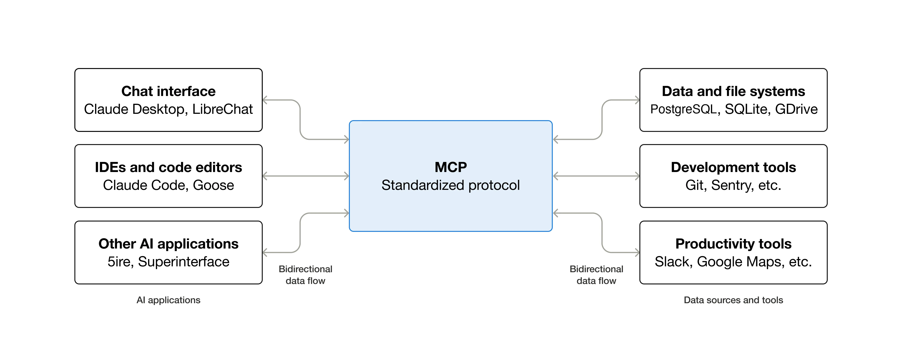
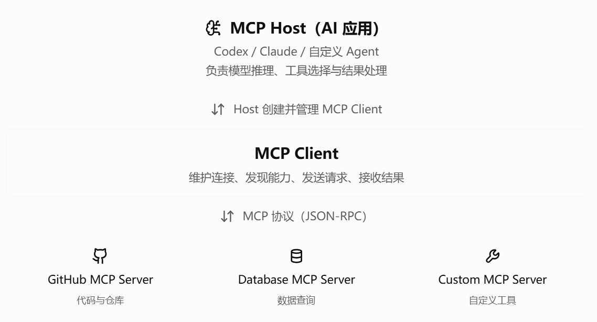
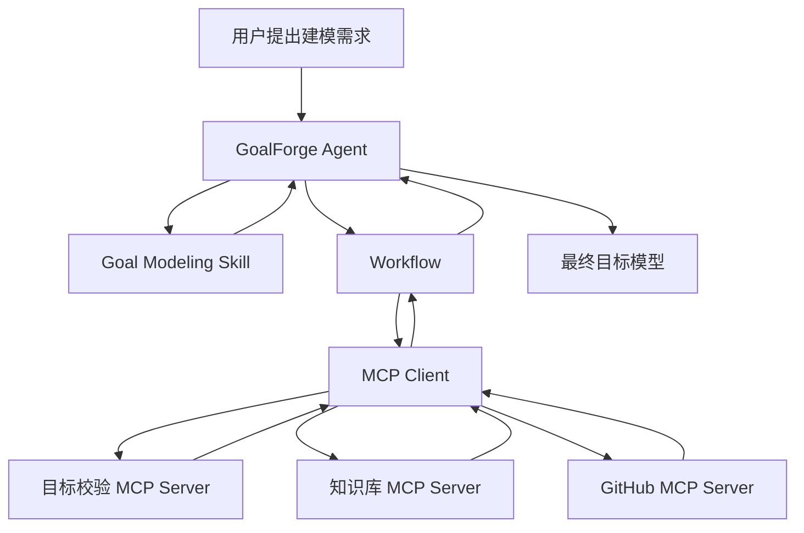

## 简介

**MCP（Model Context Protocol， 模型上下文协议）**：是一种开放标准协议，用于让 AI 应用以统一的方式连接外部工具、数据源和服务

[官方介绍](https://modelcontextprotocol.io/docs/2026-07-28/getting-started/intro)

简单来说，**通过MCP**，像 Claude 与 ChatGPT 这类的 AI 应用可以
1. 直接访问一些数据资源（e.g. local files, databases）
2. 使用一些 tools (e.g. search engines, calculators) 和 workflows (e.g. specialized prompts)

也正是MCP搭建了如今 harness+llm 的 agent 模式的通信地基

## MCP 基本架构

MCP 采用经典 **Client - Server** 架构，主要包含三个核心模块

1. **MCP Host**：用户直接交互的 AI 应用，负责管理模型与工具（e.g. Claude, ChatGPT）
2. **MCP Client**：Host 内部的协议客户端，通常一个 Server 对应一个 Client 连接
3. **MCP Server**：向外暴露工具、资源和题时模板的服务程序（通常为 .py 文件）

且若是在Codex 或者 Claude Code 中使用，**普通 MCP 开发者**一般多为创建 MCP Server，Host 与 Client 通常复用现成的实现

[普通开发者如何创建自己的 MCP Server](./如何创建MCP%20Server.md)

| MCP 组件 | 示例                                   |
| ------ | ------------------------------------ |
| Host   | Codex、Claude Desktop、VS Code 等 AI 应用 |
| Client | Host 内置的 MCP 客户端                     |
| Server | 第三方服务商或开发者                           |

而如果是开发**全新的web agent应用**，通常需要自行开发 Host 与 Client
例如 GoalForge 应用：

- 自行开发 Host 应用：前端界面、用户交互、Agent 任务管理等。
- 集成 MCP Client SDK：通常依然不需要从零编写协议客户端。
- 开发自定义 MCP Server：提供目标模型分析和校验工具。

### MCP Server

MCP Servers 主要提供三种主要能力，可看[官方文档详细介绍](https://modelcontextprotocol.io/docs/2026-07-28/develop/build-server)

1. **[Resources](https://modelcontextprotocol.io/docs/2026-07-28/learn/server-concepts#resources)**: File-like data that can be read by clients (like API responses or file contents)
	向 AI Client 提供可读的上下文与接口（项目文档，配置文件）
2. **[Tools](https://modelcontextprotocol.io/docs/2026-07-28/learn/server-concepts#tools)**: Functions that can be called by the LLM (with user approval)
	向 AI Client 提供可调用的功能（查询数据库功能接口）
3. **[Prompts](https://modelcontextprotocol.io/docs/2026-07-28/learn/server-concepts#prompts)**: Pre-written templates that help users accomplish specific tasks
	提供预设的任务提示（辅助代码审查）

## MCP Skill Agent之间的联系

简单理解，skill 是 agent 内部可直接调用的技能，而 agent 需要 MCP 来获取使用外部的信息与能力

|概念|核心职责|解决的问题|
|---|---|---|
|Agent|理解任务、推理和决策|应该做什么？|
|Skill|提供专业知识与执行规范|应该如何完成？|
|MCP|标准化连接外部能力|如何调用工具、获取数据？|
|Workflow|编排执行顺序和状态|各个任务如何衔接？|

