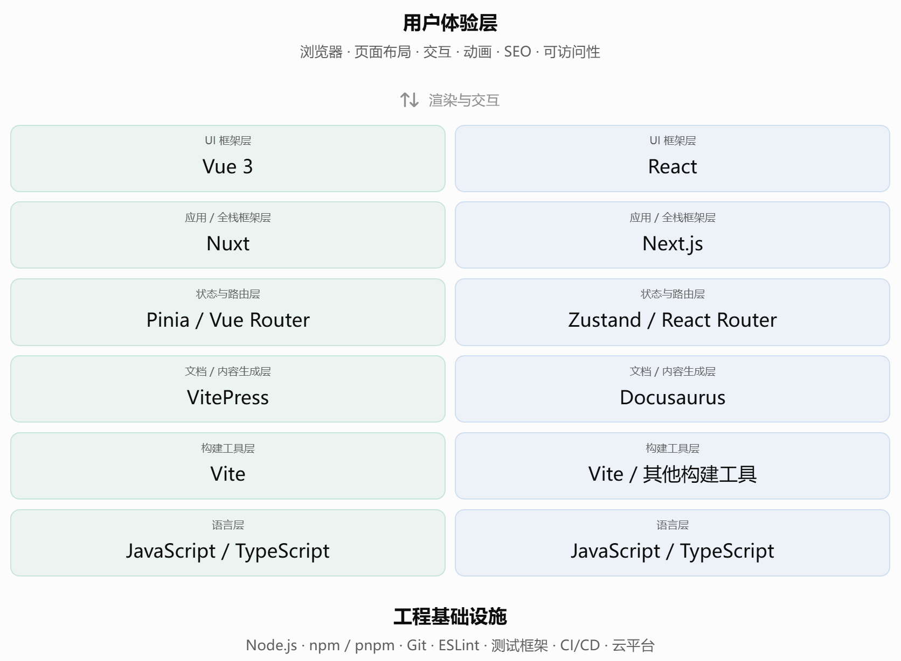
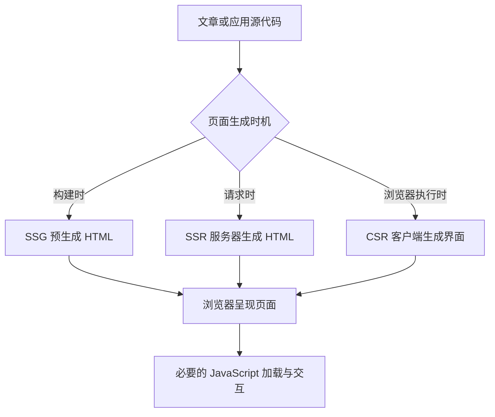
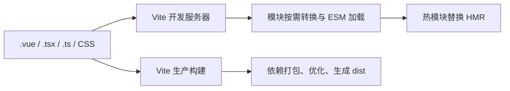
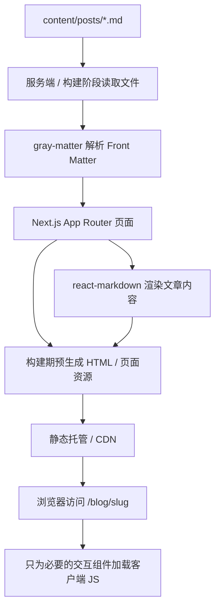

# Vue + JavaScript 与 React + TypeScript：现代 Web 全栈技术体系对比

## 1. 简介

Web 应用经历了由**静态 HTML 页面**、**原生 JavaScript 操作 DOM**、**jQuery 等工具库**，到 **Ajax 驱动的动态网页**、**组件化单页应用（SPA）**，再到如今结合**静态站点生成（SSG）、服务端渲染（SSR）、客户端渲染（CSR）与混合渲染**的工程化发展过程。

而现代 Web 开发已经可以由多个可以组合的技术层共同构成，并且在界面ui实现的基础上，还需要考虑构建、数据获取、内容管理、测试、部署和长期维护。

**Vue + JavaScript** **React + TypeScript** 是两种有代表性的组合：

1. **Vue / React**：决定组件的组织形式、状态更新机制与 UI 编程模型。
2. **JavaScript / TypeScript**：决定编写逻辑时是否引入静态类型约束。

两者可以交叉组合：**Vue + TypeScript** 与 **React + JavaScript** 同样可行。

另外 **Vite** 是两边都可使用的构建工具；**VitePress** 属于基于 Vue 与 Vite 的静态站点生成器（SSG）；**Nuxt 和 Next.js** 则分别提供 Vue、React 生态中的应用框架能力。

## 2. 技术架构对比

### 2.1 Web 技术栈整体框架一览



#### 表格一览：

| 技术层           | 应用                           | Vue 生态常见工具             | React 生态常见工具                        |
| ---------------- | ------------------------------ | ---------------------------- | ----------------------------------------- |
| 编程语言         | 控制逻辑、描述数据与模块       | JavaScript / TypeScript      | JavaScript / TypeScript                   |
| UI 组件          | 把状态映射到交互界面           | Vue 3                        | React                                     |
| 应用框架         | 路由、预渲染、服务端能力       | Nuxt                         | Next.js、React Router 框架模式            |
| 开发与构建       | 开发服务器、模块转换、生产打包 | Vite                         | Vite；Next.js 有自己的工具链              |
| 文档与内容站     | Markdown 编译、路由、主题、SEO | VitePress                    | Docusaurus、MDX 方案                      |
| 路由             | URL 与页面映射                 | Vue Router                   | React Router；Next.js App Router          |
| 客户端共享状态   | 跨组件数据管理                 | Pinia                        | Zustand、Redux、Context 等                |
| 服务端数据状态   | 请求、缓存、重试、失效         | TanStack Query Vue 等        | TanStack Query React 等                   |
| UI 与样式        | 组件样式、设计系统、动画       | CSS、Tailwind CSS、Vue UI 库 | CSS、Tailwind CSS、shadcn/ui、React UI 库 |
| 测试与质量       | 校验逻辑、类型与用户流程       | vue-tsc、Vitest、Playwright  | tsc、Vitest、Playwright                   |
| 包管理与运行环境 | 安装依赖、执行脚本             | Node.js + npm / pnpm         | Node.js + npm / pnpm                      |
| 部署与运维       | 发布、缓存、持续集成、监控     | 静态托管或服务器平台         | 静态托管或服务器平台                      |

### 2.2 完整方案框架

| 对比目标        | 方案 A                                       | 方案 B                                             | 主要差异                           |
| --------------- | -------------------------------------------- | -------------------------------------------------- | ---------------------------------- |
| 客户端交互应用  | Vue + Vite + TypeScript + Vue Router + Pinia | React + Vite + TypeScript + React Router + Zustand | 组件模型、状态及路由集成方式       |
| 文档 / 博客     | Vue + VitePress + Markdown                   | React + Docusaurus + Markdown/MDX                  | 内容扩展、主题及文档能力           |
| 全栈 / SSR 网站 | Vue + Nuxt + TypeScript                      | React + Next.js + TypeScript                       | 服务端组件与数据获取模型、部署方式 |
| 基础语言        | JavaScript                                   | TypeScript                                         | 类型安全与开发成本                 |

另外此部分所强调的 Vue/JS 与 React/TS 对比仅作为方案对比学习：而真正做项目落地选型时，应该尽量在**相同项目类型、相同渲染需求、相近工程投入**的条件下比较。

#### 典型 SPA 项目的目录对照（组件化单页应用）

```text
Vue + Vite                         React + Vite
├── public/                        ├── public/
├── src/                           ├── src/
│   ├── components/*.vue           │   ├── components/*.tsx
│   ├── views/*.vue                │   ├── pages/*.tsx
│   ├── composables/               │   ├── hooks/
│   ├── router/                    │   ├── routes/
│   ├── stores/                    │   ├── stores/
│   ├── App.vue                    │   ├── App.tsx
│   └── main.ts                    │   └── main.tsx
├── index.html                     ├── index.html
├── vite.config.ts                 ├── vite.config.ts
├── tsconfig.json                  ├── tsconfig.json
└── package.json                   └── package.json
```

这两份目录是用于对比的**结构**：其中 Vue Router、Pinia、React Router、Zustand 等模块需要根据实际选型安装和配置。

Vite 项目通常以 `index.html` 为入口，通过 `main.ts(x)` 挂载应用；`App.vue` 和 `App.tsx` 负责根组件，`components/` 管理复用 UI，`views/` 或 `pages/` 管理页面级模块。

### 2.3 CSR、SSR、SSG 与混合渲染对比

- **CSR（客户端渲染）**：初始页面加载 JS 后在浏览器生成主要界面；适合**高交互应用和登录后平台**。首次内容展示与 SEO 需要特别优化。
- **SSR（服务端渲染）**：请求到达服务器后生成相应 HTML，客户端再完成必要的 Hydration；**适合动态内容、公开 SEO 页面与个性化服务。**
- **SSG（静态站点生成）**：构建时把已知页面生成 HTML；**适合博客、技术文档、作品集等更新频率较低的页面。**
- **Hybrid（混合策略）**：为不同页面分别选择静态预生成、服务端生成或客户端交互；适合同时拥有博客、动态模块和账户功能的综合站点。



这里的渲染策略与框架选择并行：Vue / React 都能够支持多种渲染策略，实际能力由 VitePress、Nuxt、Next.js 等具体方案决定。SSR 和 SSG 输出的 HTML 可以被浏览器直接读取，交互区域仍可能需要加载 JS。

## 3. Vue 与 React的核心特征分析

### 3.1 语言对比

#### 3.1.1 JavaScript

JavaScript 是**现代浏览器支持的脚本语言**，具备**动态类型**、函数一等公民、原型机制、闭包、事件循环、Promise、ES Modules 等语言特征。它可以运行在浏览器，也可以借助 Node.js 等运行时执行在服务端或工程工具链中。

```js
function formatUser(user) {
  return `${user.name} (${user.age})`
}

formatUser({ name: 'Alice', age: '20' })
```

这里没有为 `age` 设置静态类型约束。JavaScript 会在运行时处理传入值，开发者可以使用测试、JSDoc 和运行时验证强化约束。

#### 3.1.2 TypeScript

TypeScript 在 JavaScript 上增加**类型注解**、联合类型、接口、泛型、类型推断等能力：

```ts
interface User {
  name: string
  age: number
}

function formatUser(user: User): string {
  return `${user.name} (${user.age})`
}

formatUser({ name: 'Alice', age: '20' }) // 类型检查失败
```

TypeScript 的类型通常在**编译转换时被擦除**，浏览器最终执行的是 JavaScript。

| 维度         | JavaScript                   | TypeScript                         |
| ------------ | ---------------------------- | ---------------------------------- |
| 编码起步     | 简单直接                     | 增加类型设计成本                   |
| 运行目标     | 可直接由浏览器解释执行       | 转换为 JavaScript 后执行           |
| 错误发现     | 更多依赖运行和测试           | 许多结构性错误可在开发阶段发现     |
| 接口契约     | 文档、测试、JSDoc            | `type`、`interface`、泛型等        |
| 大型代码重构 | 依赖测试和 IDE 推断          | 类型检查有助于定位关联修改         |
| 运行性能     | 取决于 JS 产物和实现         | 类型声明本身通常不增加运行时开销   |
| 推荐场景     | 小型脚本、原型、学习语言基础 | 长期项目、多人协作、复杂组件与 API |

**建议**：个人主页如果预期持续扩展组件、博客、知识图谱和独立服务，优先使用 TypeScript，不过完整掌握 JavaScript 基础概念是为根基。

### 3.2 架构对比

#### 3.2.1 组件组织方式

Vue 通常采用单文件组件**（Single-File Component，SFC）**，一个 `.vue` 文件可以包含脚本、模板和局部样式：

```vue
<script setup lang="ts">
import { ref } from 'vue'
const count = ref(0)
</script>

<template>
  <button @click="count++">Count: {{ count }}</button>
</template>

<style scoped>
button { padding: 0.75rem; }
</style>
```

React 常采用 TSX，以 JavaScript/TypeScript 表达式描述组件树：

```tsx
'use client'
import { useState } from 'react'

export default function Counter() {
  const [count, setCount] = useState(0)
  return (
    <button onClick={() => setCount((value) => value + 1)}>
      Count: {count}
    </button>
  )
}
```

上面 React 示例含 `'use client'`，用于 Next.js App Router 的交互组件，如果只运行在普通 Vite + React 客户端应用中，这个指令可以省略。

| 比较项   | Vue                           | React                     |
| -------- | ----------------------------- | ------------------------- |
| 组件定义 | `.vue` + Template / Script    | 函数组件 + JSX/TSX        |
| 局部状态 | `ref`、`reactive`             | `useState`、`useReducer`  |
| 派生数据 | `computed`                    | 普通计算、`useMemo` 等    |
| 事件绑定 | `@click` / `v-on`             | `onClick`                 |
| 条件渲染 | `v-if` / `v-show`             | 条件表达式                |
| 列表渲染 | `v-for`                       | `map` 等 JS 表达式        |
| 逻辑复用 | Composition API / Composables | 自定义 Hooks              |
| 样式隔离 | `scoped` CSS、CSS Modules 等  | CSS Modules、CSS-in-JS 等 |

#### 3.2.2 状态驱动更新的内部原理

**Vue 3：响应式依赖追踪**

1. `reactive` 通过代理对象属性读写，`ref` 提供响应式值容器。
2. 组件渲染或计算属性执行时，框架记录读取过的响应式依赖。
3. 依赖发生变化后，Vue 调度相关计算或组件更新。
4. 模板编译时可识别静态与动态部分，协助缩小运行时更新范围。

**React：状态驱动的渲染与协调**

1. 组件调用状态更新函数，如 `setCount`。
2. React 调度渲染，执行组件函数，生成新的 UI 描述。
3. 协调过程比较新旧渲染结果。
4. 提交阶段只执行必要的 DOM 修改。

#### 3.2.3 状态管理、路由与数据请求

要区分三个不同层次的状态：

- **局部 UI 状态**：菜单是否展开、输入框内容，优先放在组件内部。
- **跨组件共享状态**：主题、全局面板状态等，Vue 可用 Pinia；React 可用 Context、Zustand 等。
- **服务端数据状态**：文章列表、搜索结果和用户数据，涉及请求、缓存、失效和重试，可使用框架自带数据获取机制或 TanStack Query。

路由方面，Vue SPA 通常使用 **Vue Router**，React SPA 可选择 **React Router**；Nuxt 与 Next.js 则具备框架内置的路由系统。

### 3.3 优劣

| 评价维度         | Vue 生态                                 | React 生态                                    |
| ---------------- | ---------------------------------------- | --------------------------------------------- |
| 初学体验         | 模板语法贴近 HTML，上手路径较集中        | JSX、Hooks 与组件函数需要更多概念准备         |
| 表达方式         | 模板与逻辑分区清楚                       | TSX 能直接使用语言表达式组织组件              |
| 响应式模型       | 自动追踪依赖，开发体验直接               | 状态更新显式，数据流和函数组件关系清楚        |
| 工程配套         | Vue Router、Pinia、Vite、Nuxt、VitePress | Next.js、React Router、MDX 与广泛 UI 组件生态 |
| 项目定制         | 适合逐步增强与常规应用                   | 适合组件高度组合和跨产品复用                  |
| 需要掌握的易错点 | `ref.value`、解构后的响应性、代理引用    | 闭包、依赖数组、状态不可变更新、客户端边界    |
| 性能取舍         | 模板编译优化成熟                         | 组件协调和编译优化持续发展                    |
| 团队长期维护     | 依赖约定、测试、模块边界和文档           | 同样依赖约定、测试、模块边界和文档            |

**结论**：对中小型内容站，Vue/VitePress 往往有直接的开发体验；若优先考虑 React 组件生态、复杂动画与后续互动功能，React + TypeScript 的扩展路线值得优先评估。开发效率与架构质量最终依赖团队经验和项目约束。

## 4. 其余组件与技术介绍

### 4.1 Node.js、npm、pnpm：运行和依赖管理

- **Node.js**：在本地运行 Vite、Next.js、TypeScript 等开发工具，也可以运行服务端 JS。
- **npm / pnpm**：读取 `package.json`，安装与锁定依赖，并根据 `scripts` 执行脚本。
- **`package.json`**：描述项目脚本、直接依赖与开发依赖。
- **`pnpm-lock.yaml`**：记录解析后的依赖版本，是可复现安装与 CI/CD 的基础。

```bash
pnpm install       # 安装项目依赖
pnpm dev           # 执行开发脚本
pnpm build         # 执行构建脚本
pnpm exec tsc --noEmit  # 需要单独类型检查时执行
```

Node.js 提供工具运行环境，包管理器负责依赖管理，具体的构建逻辑则由 Vite / Next.js 等工具完成。

### 4.2 Vite：开发服务器与生产构建工具

**Vite 同时支持 Vue、React 等前端应用**，主要承担两个阶段的工作。



开发阶段依靠 ESM、依赖预构建和 HMR 提供快速反馈；生产阶段将模块组织为优化后的静态资源。**当前 Vite 官方文档以 Rolldown 介绍生产打包**，旧教程可能使用 Rollup/esbuild 解释相关流程，阅读时应对照项目版本。Vite 偏重代码转换，TypeScript 的完整类型检查应由 `tsc` / `vue-tsc` 等工具执行。

示例：

```bash
# Vue SPA
pnpm create vue@latest

# React SPA
pnpm create vite react-app --template react-ts
```

两套应用通常都通过 `pnpm dev` 运行本地开发服务器，通过 `pnpm build` 生成 `dist/`。

> **另外**：Next.js 有自己的开发服务器和构建系统，当前使用 Turbopack 作为默认构建工具；选择 Next.js 时通常不需要另装 Vite。

### 4.3 VitePress、Docusaurus 与 MDX：内容站点技术

- **VitePress**：Vue + Vite 生态的静态站点生成器。Markdown 可以映射为页面，内置文档导航和主题；在首次交付预生成 HTML 后，可实现 SPA 式站内跳转。
- **Docusaurus**：React 生态的文档站点方案，提供文档版本管理、导航和 MDX 扩展等功能。
- **MDX**：允许在 Markdown 中编写或引用 React 组件，适合包含交互图表、演示组件和自定义排版的内容。
- **Nuxt / Next.js**：偏向通用应用框架，适合在内容之外扩展动态功能、用户状态、服务端 API 或 SSR。

VitePress 快速搭建：

```bash
mkdir vue-docs && cd vue-docs
pnpm init
pnpm add -D vitepress@next
pnpm vitepress init
pnpm docs:dev
```

其中 `vitepress@next` 是本文核对时官方入门指南展示的安装标签；实际生产项目应确认具体发布版本并使用锁文件。若自定义主题使用 Vue API，需显式安装 `vue`。

Docusaurus 快速搭建：

```bash
npx create-docusaurus@latest react-docs classic --typescript
cd react-docs
npm run start
```

### 4. 4 TypeScript、ESLint、测试与 CI/CD 的分工

| 工具               | 职责               | 主要检查什么                     |
| ------------------ | ------------------ | -------------------------------- |
| TypeScript / `tsc` | 静态类型检查       | 属性、参数、返回值等类型约束     |
| `vue-tsc`          | Vue SFC 类型检查   | `.vue` 模板与脚本的类型问题      |
| ESLint             | 代码质量与规则检查 | 代码模式、Hook 规则、潜在问题    |
| Prettier           | 格式化             | 缩进、换行、标点等代码风格       |
| Vitest             | 单元 / 组件级测试  | 函数、模块和交互逻辑             |
| Playwright         | 端到端测试         | 浏览器中真实的关键用户流程       |
| GitHub Actions     | 自动化流水线       | 拉取代码、安装、检查、构建、部署 |

推荐流程：

```text
编写代码 → 格式与规则检查 → 类型检查 → 单元测试
        → 端到端测试 → 生产构建 → 预览 → 自动部署
```

## 5. 个人主页 / 博客：组件与跨生态扩展优先的完整架构

> **选型前提**：网站以个人介绍、作品展示、博客文章为主；希望长期增加复杂动画、交互式组件、知识图谱和外部 API 集成。此处选择以 React 生态为中心的技术栈，与前文的通用框架比较相互补充。

### 5.1 推荐架构与适用边界

**推荐起点：Next.js App Router + React + TypeScript + Tailwind CSS + 本地 Markdown（按需 MDX）+ pnpm。**

这套方案有三点主要考虑：

1. **内容与 SEO**：个人主页和文章页可以生成 HTML，利于内容展示和搜索引擎读取。
2. **组件扩展**：React/TSX 易于接入交互组件、图谱可视化、动画与外部服务。
3. **渐进部署**：早期可使用静态导出；需要动态权限、服务端读写或 BFF 时再切换到支持服务器能力的部署模式。

需要明确的成本是：Next.js 涉及 App Router、Server Components、Client Components、数据获取与缓存等概念；如果网站仅包含几篇静态文章，VitePress 或 Astro 等轻量内容方案可能更省事。

### 5.2 技术选型与依赖分级

| 能力         | 起步选择                                | 选择原因                                 | 是否立即引入         |
| ------------ | --------------------------------------- | ---------------------------------------- | -------------------- |
| 核心框架     | Next.js + React                         | 路由、预渲染及后续服务端能力             | 是                   |
| 语言         | TypeScript                              | 组件与数据契约、重构支持                 | 是                   |
| 包管理       | pnpm                                    | 锁文件、统一脚本                         | 是                   |
| UI 样式      | Tailwind CSS + 普通 CSS                 | 快速布局且可保留自定义视觉语言           | 是                   |
| 基础文章     | Markdown + gray-matter + react-markdown | 保留现有 YAML Front Matter 的 `.md` 文档 | 是                   |
| GFM 语法     | remark-gfm                              | 表格、任务列表等 Markdown 扩展           | 按需                 |
| 交互文章     | `@next/mdx`                             | 在部分文章中嵌入 React 组件              | 第二阶段             |
| 基础 UI 组件 | shadcn/ui 等                            | 复用交互基础与可访问性实现               | 按需                 |
| 动画         | Motion 等                               | 为少数区域增加受控动效                   | 按需                 |
| 全局状态     | Zustand                                 | 复杂跨组件状态共享                       | 需要后再加           |
| 服务端缓存   | TanStack Query                          | 客户端远程数据管理                       | 需要后再加           |
| 数据库与认证 | PostgreSQL / 认证服务                   | 评论、后台、私有内容等                   | 第三阶段             |
| E2E 测试     | Playwright                              | 验证导航、文章和响应式布局               | 应在首个稳定版本加入 |

**依赖原则**：每一个库都应对应明确的产品能力。已有 Next.js 状态和数据获取机制足够解决的问题，无需立即额外叠加第三方库。

### 5.3 推荐目录结构及职责

以下目录属于**建议的工程组织方式**，并非 `create-next-app` 一次性生成的全部文件。

```text
personal-site/
├── public/                       # 公共静态文件（照片、图标等）
│   └── images/
├── content/
│   └── posts/                    # 原始 Markdown 文章，保留 YAML 元数据
│       └── first-post.md
├── src/
│   ├── app/                      # App Router：目录即路由约定
│   │   ├── layout.tsx            # 根布局：HTML、导航、全站样式
│   │   ├── page.tsx              # 首页 /
│   │   ├── globals.css
│   │   ├── about/page.tsx        # /about
│   │   ├── projects/page.tsx     # /projects
│   │   └── blog/
│   │       ├── page.tsx          # /blog 文章列表
│   │       └── [slug]/page.tsx   # /blog/first-post 文章详情
│   ├── components/
│   │   ├── layout/               # Header、Footer 等通用布局
│   │   ├── ui/                   # Button、Card 等基础组件
│   │   ├── blog/                 # 目录、文章列表、标签组件
│   │   └── interactive/          # 客户端图谱、动态效果组件
│   ├── lib/
│   │   ├── posts.ts             # 读取 Markdown、解析元数据
│   │   └── utils.ts             # 通用函数
│   ├── types/                    # 内容与业务类型
│   └── styles/                   # 设计令牌、通用样式
├── next.config.ts                # Next.js 构建与部署配置
├── package.json                  # 脚本与依赖
├── pnpm-lock.yaml                # 固定依赖解析结果
├── tsconfig.json                 # TypeScript 配置
└── eslint.config.mjs             # 代码规则
```

组织原则：

- `app/` 尽量以页面和路由为核心，避免堆放大量业务逻辑。
- `components/ui/` 放通用、可复用、不依赖具体业务的组件。
- `components/interactive/` 负责依赖浏览器事件、动画和可视化库的客户端组件。
- `content/` 保存原始文章，与页面展示逻辑分离。
- `lib/posts.ts` 负责从文件系统读取、校验和解析文章，供列表页及详情页共用。
- API、数据库、认证等尚未使用的模块不需要预建空目录。

### 5.4 从零初始化与依赖安装

建议先安装符合当前 Next.js 要求的 Node.js LTS 版本，再执行：

```bash
# 1. 创建工程，按需选择 TypeScript、App Router、src/、Tailwind、ESLint
pnpm create next-app@latest personal-site

# 2. 进入项目
cd personal-site

# 3. 为现有 .md + YAML Front Matter 文章安装内容解析依赖
pnpm add gray-matter react-markdown remark-gfm

# 4. 启动开发服务器
pnpm dev
```

然后在 `content/posts/` 创建文章，通过 `src/lib/posts.ts` 读取并解析，在 App Router 页面中渲染。

当前 Next.js 默认开发与生产构建使用其自身的 Turbopack 工具链，**不要因为前文介绍了 Vite 就给 Next.js 项目另装 Vite**。

#### 示例文章：`content/posts/first-post.md`

```md
---
title: '第一篇文章'
description: '个人站点的第一篇学习笔记'
date: '2026-11-09'
tags:
  - Web
  - React
---

# 第一篇文章

这里是使用 Markdown 编写的内容。
```

#### 示例文章解析：`src/lib/posts.ts`

```ts
import 'server-only'
import fs from 'node:fs'
import path from 'node:path'
import matter from 'gray-matter'

const postsDir = path.join(process.cwd(), 'content', 'posts')

export function getAllSlugs(): string[] {
  return fs.readdirSync(postsDir)
    .filter((name) => name.endsWith('.md'))
    .map((name) => name.slice(0, -3))
}

export function getPostBySlug(slug: string) {
  // 将 URL 参数限定为可预期的文件名，避免目录穿越
  if (!/^[a-zA-Z0-9-]+$/.test(slug)) return null

  const file = path.join(postsDir, `${slug}.md`)
  if (!fs.existsSync(file)) return null

  const raw = fs.readFileSync(file, 'utf8')
  const { data, content } = matter(raw)
  return {
    slug,
    title: typeof data.title === 'string' ? data.title : slug,
    description: typeof data.description === 'string' ? data.description : '',
    content,
  }
}
```

此例使用 `server-only` 明确防止文件系统读取模块被客户端组件导入；需安装该轻量标记包：

```bash
pnpm add server-only
```

正式使用时还应验证日期、标签等 Front Matter 字段，必要时采用 Zod 为内容模式建立统一校验。

#### 动态文章路由：`src/app/blog/[slug]/page.tsx`

```tsx
import { notFound } from 'next/navigation'
import ReactMarkdown from 'react-markdown'
import remarkGfm from 'remark-gfm'
import { getAllSlugs, getPostBySlug } from '@/lib/posts'

// 静态生成所有已知文章路由
export function generateStaticParams() {
  return getAllSlugs().map((slug) => ({ slug }))
}

export const dynamicParams = false

type Props = {
  params: Promise<{ slug: string }>
}

export async function generateMetadata({ params }: Props) {
  const { slug } = await params
  const post = getPostBySlug(slug)
  return {
    title: post?.title ?? '文章不存在',
    description: post?.description ?? '',
  }
}

export default async function BlogPostPage({ params }: Props) {
  const { slug } = await params
  const post = getPostBySlug(slug)
  if (!post) notFound()

  return (
    <article>
      <h1>{post.title}</h1>
      <ReactMarkdown remarkPlugins={[remarkGfm]}>
        {post.content}
      </ReactMarkdown>
    </article>
  )
}
```

这个最小实现展示了“Markdown 文件 → 构建时读取 → 页面路由 → React 渲染”的基本链路，并通过 `generateMetadata` 设置基本文章标题和摘要。实际网站还应为文章添加排版样式、列表页、时间与标签、目录及完整的 404 页面等。`react-markdown` 默认不会直接执行 Markdown 中的原始 HTML，开放作者输入时应持续关注内容安全。

#### 博客列表：`src/app/blog/page.tsx`

```tsx
import Link from 'next/link'
import { getAllSlugs, getPostBySlug } from '@/lib/posts'

export default function BlogIndexPage() {
  const posts = getAllSlugs()
    .map((slug) => getPostBySlug(slug))
    .filter((post) => post !== null)

  return (
    <main>
      <h1>文章列表</h1>
      <ul>
        {posts.map((post) => (
          <li key={post.slug}>
            <Link href={`/blog/${post.slug}`}>{post.title}</Link>
          </li>
        ))}
      </ul>
    </main>
  )
}
```

至此，`/blog` 列表页与 `/blog/first-post` 详情页的主要数据链路已经闭合。发布新文章时，在 `content/posts` 中新增带合法 slug 的 `.md` 文件并重新构建即可。

> **有关 MDX 的重要区别**：Next.js 官方 `@next/mdx` 默认不解析 YAML Front Matter。如果当前文章已经采用本文开头的 Front Matter 格式，建议先使用 `gray-matter`；仅在需要把 React 交互组件嵌入文章时再引入 MDX，并配置元数据方案。不要直接将现有 `.md` 改名为 `.mdx` 后假定一切兼容。

### 5.5 运行原理：一篇文章和一个交互组件如何显示



对静态博客页而言，用户首次访问即可获得预渲染页面；涉及鼠标追踪、实时筛选、知识图谱、拖拽、动画等交互能力时，将相应区域封装为带 `'use client'` 的组件。在 Next.js 中，`'use client'` 标记的是一个**客户端模块边界**，其导入的子模块也会进入客户端模块图，因此应尽量放在真正需要交互的叶子组件附近。

例如：

```tsx
// src/components/interactive/ThemeToggle.tsx
'use client'
import { useState } from 'react'

export default function ThemeToggle() {
  const [dark, setDark] = useState(false)
  return (
    <button onClick={() => setDark((value) => !value)}>
      {dark ? '当前：深色' : '当前：浅色'}
    </button>
  )
}
```

此代码仅演示客户端状态更新，真正切换全站主题还需要把状态与根元素主题类、持久化偏好以及服务端初始渲染策略连接起来。

### 5.6 跨生态扩展的技术边界

| 扩展能力            | 推荐集成方向                          | 应注意的问题                           |
| ------------------- | ------------------------------------- | -------------------------------------- |
| 博客文章            | Markdown + Front Matter               | 内容模式、SEO、静态路由                |
| 高交互文章          | MDX + 自定义 React 组件               | MDX 编译和不可信内容处理               |
| 知识图谱            | React 客户端组件 + 图可视化库         | 大数据量、懒加载、浏览器性能           |
| 动态动画            | CSS 优先，Motion 按需                 | 无障碍减少动态效果偏好、性能           |
| 在线演示 / 代码沙盒 | 隔离的前端组件或外部沙盒              | 安全隔离、网络资源加载                 |
| AI 搜索 / RAG       | 前端请求独立后端 API / BFF            | 认证、流式传输、费用与限流             |
| 评论 / 登录         | 独立服务或受保护服务端路由            | 权限、安全、数据库与隐私               |
| 跨平台共享          | 提取纯 TypeScript 类型、SDK、工具函数 | Web DOM 组件不能直接视为跨平台通用组件 |

建议把**文章内容、UI 展示、数据访问、业务类型、浏览器交互**拆成不同模块。后续即使将 RAG 后端换成 Python 服务、将可视化模块换成其他库，也不会影响 Markdown 内容组织或站点整体路由。

### 5.7 开发、测试与部署流程

**本地开发**：

```bash
pnpm install
pnpm dev            # 访问本地开发地址
pnpm exec tsc --noEmit
pnpm exec eslint .
pnpm build          # 检查正式构建
```

`create-next-app` 会生成相应的配置和脚本；若自定义 `package.json`，建议至少保留 `dev`、`build`、`start`、`lint` 等任务。博客上线前应测试首页、文章链接、404、移动端导航、深浅色模式与核心可访问性行为。

**部署方式 A：静态导出，适合初期个人站。**

在不需要运行时**服务端 API、动态鉴权**等功能时，配置：

```ts
// next.config.ts
import type { NextConfig } from 'next'

const nextConfig: NextConfig = {
  output: 'export',
}

export default nextConfig
```

执行：

```bash
pnpm build
```

静态构建产物通常位于 `out/`，可部署到 GitHub Pages、静态文件服务器及支持静态资源的托管平台。若使用仓库子路径，仍要检查 `basePath`、资源路径和托管平台规则；`next/image` 的默认服务器端优化能力不适用于纯静态导出，需要禁用默认优化或采用兼容的图片加载方案。

**部署方式 B：支持 SSR 与服务端功能的平台。**

当未来增加后台登录、运行时数据查询或服务端 API 时，去掉 `output: 'export'`，使用支持完整 Next.js 运行时的托管平台，或者自行部署 Node.js 服务器：

```bash
pnpm build
pnpm start
```

不能把静态导出目录理解为完整的服务端应用：静态导出不支持依赖运行时服务器的 API、动态渲染及部分服务端特性。若采用 Vercel 等平台，先检查所选项目与服务端功能是否得到支持，并在部署平台配置环境变量。

**推荐的 CI/CD：**

```text
推送 Git 分支
  → 安装依赖（pnpm install --frozen-lockfile）
  → ESLint 与 TypeScript 检查
  → 单元 / 端到端测试
  → Next.js 生产构建
  → 部署预览环境
  → 人工确认并发布
  → 监控异常与回滚
```

### 5.8 迭代顺序与实施边界

**阶段一：可发布的基础个人站**

完成主页、关于、项目列表、博客列表与文章详情；优先做好排版、响应式、SEO、语义化结构和基础构建部署。保持内容为仓库内 Markdown。

**阶段二：有节制地增强交互**

加入部分动态组件、页面过渡、文章目录、标签检索、主题切换；为复杂组件设置延迟加载，考虑 `prefers-reduced-motion`。只有确实需要嵌入交互演示的文章才引入 MDX。

**阶段三：数据与服务扩展**

加入 RAG 搜索、可视化知识图谱、访问统计或用户功能时，再确定 API、数据库、认证、服务器部署方案。优先复用已有模块和后端服务，不必重构整个前端项目。

**本次选型结论**：对于强调组件生态与持续扩展的个人主页 / 博客，**Next.js + React + TypeScript** 是适合长期演化的技术起点；对于内容占绝对主导、交互很少的情况，Vue + VitePress 仍然是开发与运维成本更低的备选。技术选型应服从网站目标，不需要为了覆盖全部 Web 技术而在同一个仓库中混用多种完整应用框架。

## 6. 开发者选择

### 6.1 以需求推导技术栈

```text
明确网站形态和目标用户
   ↓
判断页面以内容为主还是交互为主
   ↓
选择 CSR / SSG / SSR 或混合方案
   ↓
选择 Vue / React 及相应应用框架
   ↓
配置 TypeScript、路由、内容处理与基础样式
   ↓
针对真实需求选择状态管理和第三方组件
   ↓
规划测试、部署方式、监控与扩展边界
```

| 开发目标                   | 优先考虑                                    | 理由                            |
| -------------------------- | ------------------------------------------- | ------------------------------- |
| 纯文档和学习笔记           | Vue + VitePress                             | Markdown 友好、部署简单         |
| React 生态产品文档         | Docusaurus                                  | 版本文档、MDX 与主题能力        |
| 通用客户端交互应用         | Vue/React + Vite + TypeScript               | 构建简单、前后端分离方便        |
| 需要 SSR 或服务端逻辑      | Nuxt / Next.js                              | 内置路由和服务端能力            |
| 可长期扩展的个人主页与博客 | React + Next.js + TypeScript + Markdown/MDX | 内容呈现与 React 交互组件可结合 |

### 6.2 学习路线建议

1. **Web 与 JavaScript 基础**：HTML、CSS、DOM、ES Modules、异步编程、Fetch、HTTP。
2. **工程工具链**：Node.js、pnpm、`package.json`、Vite 开发与打包、Git。
3. **TypeScript**：基础类型、接口、泛型、联合类型、类型缩小和外部数据验证。
4. **组件框架**：在 Vue 的响应式与 React 的状态更新模型之间建立对应认识。
5. **应用开发**：路由、数据请求、表单、组件复用和测试。
6. **内容与全栈**：Markdown/MDX、SSG/SSR、Next.js App Router、部署及 SEO。

建议以**一个现有的个人主页或博客项目**作为实践载体，将新学的组件、类型、构建流程逐步应用进去，避免为了比较两套框架重复启动大规模项目。

### 6.3 易混淆概念总结

- **React 不是 TypeScript，Vue 也不等于 JavaScript**：UI 框架和语言层可以自由组合。
- **Vite 不是 VitePress**：前者主要是开发与构建工具，后者是文档型静态站点生成器。
- **Next.js 不是 Vite 的插件**：它使用独立的构建与运行体系。
- **Vite 能转换 TypeScript，但不代替全面的类型检查**。
- **静态生成不意味着没有交互**：静态页面仍可以加载客户端 JavaScript。
- **Next.js Server Component 不代表所有组件都在服务器上交互**：需要事件和浏览器 API 的部分应放入客户端组件。
- **TypeScript 不会自动验证网络返回的数据**。
- **VitePress、Docusaurus、Nuxt、Next.js 的定位不完全相同**：需要先按内容站、交互应用或全栈应用确定比较范围。

## 7. 参考内容

1. [Vue 官方指南与快速开始](https://vuejs.org/guide/quick-start) — Vue SFC、`create-vue`、TypeScript 与相关工程选项。
2. [Vue 响应式原理](https://vuejs.org/guide/extras/reactivity-in-depth.html) — `ref`、代理对象和依赖追踪。
3. [React Learn](https://react.dev/learn) — 组件、状态、Hooks 的基础编程模型。
4. [React：Render and Commit](https://react.dev/learn/render-and-commit) — 更新触发、渲染与 DOM 提交。
5. [TypeScript Handbook](https://www.typescriptlang.org/docs/handbook/intro.html) — 静态类型系统与编译机制。
6. [Vite 官方指南](https://vite.dev/guide/) — 原生 ESM 开发模式、生产构建与工具链。
7. [VitePress 快速开始](https://vitepress.dev/guide/getting-started) — 文档项目初始化、文件结构与构建输出。
8. [Docusaurus 文档](https://docusaurus.io/docs) — React 文档站、MDX 与版本化文档。
9. [Nuxt 文档](https://nuxt.com/docs) — Vue 全栈应用框架。
10. [Next.js App Router 安装指南](https://nextjs.org/docs/app/getting-started/installation) — 项目创建、目录约定、Turbopack 与运行命令。
11. [Next.js Server / Client Components](https://nextjs.org/docs/app/getting-started/server-and-client-components) — 服务端、客户端组件边界与 Hydration。
12. [Next.js MDX 指南](https://nextjs.org/docs/app/guides/mdx) — MDX 组件、文章路由及 Front Matter 处理选项。
13. [Next.js 部署指南](https://nextjs.org/docs/app/getting-started/deploying) — Node.js、Docker 与静态导出。
14. [Next.js 静态导出说明](https://nextjs.org/docs/app/guides/static-exports) — `output: 'export'` 与不支持的服务器特性。
15. [Vitest 文档](https://vitest.dev/guide/) — 单元与组件测试。
16. [Playwright 文档](https://playwright.dev/docs/intro) — 浏览器端到端测试。
